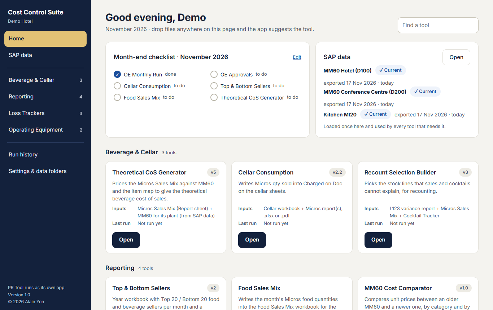
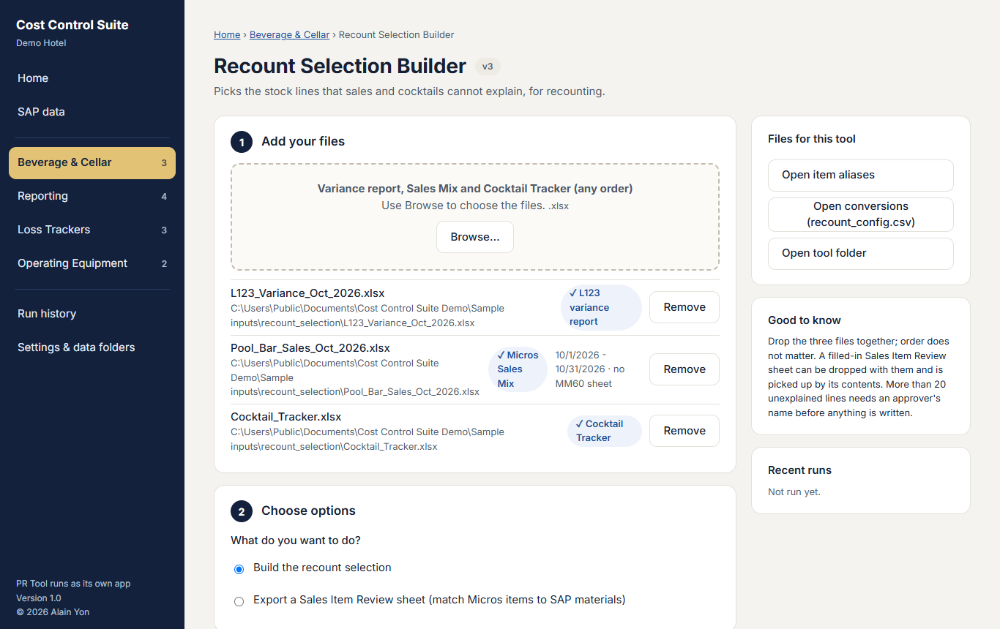
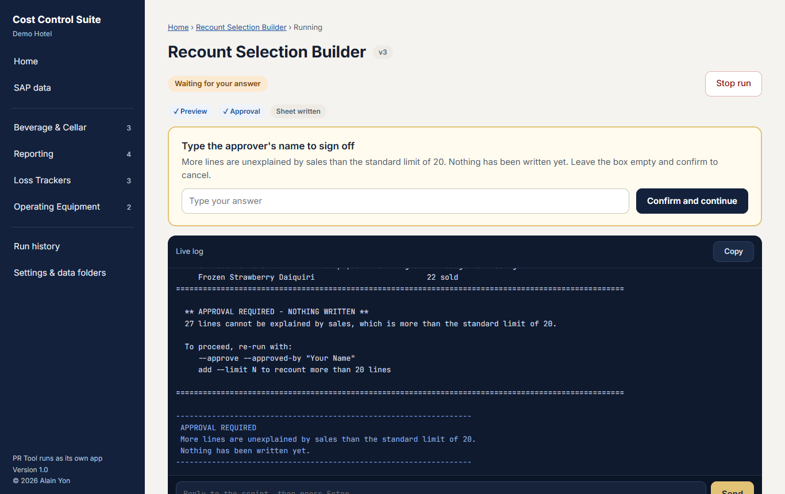
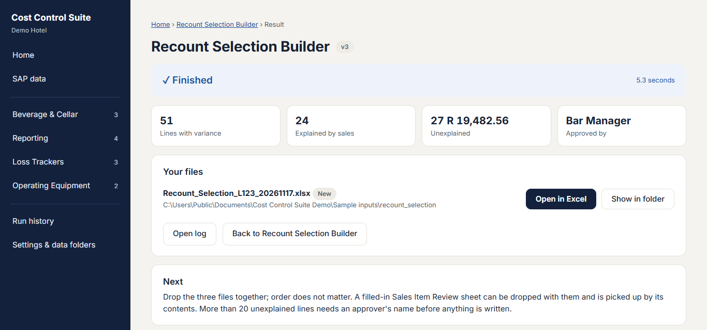

# Cost Control Suite (demo)

A Windows desktop app that brings twelve hotel cost-control tools into one window. This public copy runs on
generated sample data for a fictional **Demo Hotel**.



## The problem

Month-end cost control in a hotel is a chain of manual checks. SAP stock exports, Micros point-of-sale reports and
cellar sheets are compared by hand in Excel, documents go missing between departments, and stock variances are
followed up late because nobody can quickly see which lines matter. The Cost Control Suite turns those checks into
repeatable tools. Each one takes the exports exactly as they come out of SAP and Micros, checks them before it starts,
writes the working files, and points to what needs a person's attention: lines to recount, items with no match,
losses against budget, operating equipment to reorder. The app puts the tools in one window with shared SAP data, a
month-end checklist and a run history.

## Screenshots

Taken from the demo build running on the sample data (the app page, without the window frame).

| Add files and check them before a run | The run stops and asks for an approver |
|---|---|
|  |  |



## Tools

### Beverage & Cellar

- **Theoretical CoS Generator**: prices the Micros sales mix against the SAP MM60 price list and an item map to give
  the theoretical beverage cost of sales, and flags costs that look wrong.
- **Cellar Consumption**: writes Micros quantities sold into the daily cellar sheets, so missing bottles show against
  what was charged.
- **Recount Selection Builder**: picks the stock lines that sales and cocktail usage cannot explain, for recounting.
  More than 20 lines needs an approver's name.

### Reporting

- **Top & Bottom Sellers**: builds a year workbook with the top 20 and bottom 20 food and beverage sellers per month
  and a dashboard.
- **Food Sales Mix**: writes the month's Micros food quantities into the sales mix workbook for each outlet, matching
  renamed dishes.
- **MM60 Cost Comparator**: compares unit prices between two MM60 exports, by category and by item.
- **Stock Age Dashboard**: ages stock on hand against purchase history, from under a year to over five years and never
  bought.

### Loss Trackers

- **Coffee Shop Loss Tracker**: compares drinks sold with ingredients used (kitchen MI20) to value losses by ingredient.
- **Breakfast Tracker**: rebuilds the breakfast month-end workbook from the kitchen MI20, keeping the trend history.
- **Canteen Loss Tracker**: rebuilds the staff canteen month-end workbook from the kitchen MI20, with budget variance.

### Operating Equipment

- **OE Monthly Run**: builds the operating equipment tracking workbook, the department approval files and the transfer
  form from the month's SAP exports, with urgency and breakage figures.
- **OE Approvals**: reads a signed approval file and builds the approved order list for procurement, with follow-ups
  for unclear answers.

## Tech stack

- **Python 3.13** (64-bit, Windows 10 or 11)
- **pywebview** with Microsoft Edge WebView2 for the app window (through pythonnet). Without WebView2 the same page
  opens in an Edge window served on 127.0.0.1.
- **Plain HTML, CSS and JavaScript** for the interface: no framework, no build step
- **openpyxl** to read and write the Excel workbooks
- **pandas** and **numpy** for the data work
- **pdfplumber** for Micros reports saved as PDF (Cellar Consumption)
- **Windows batch installer** that builds a private virtual environment with pinned package versions
  (`installer/requirements.txt`). No admin rights and no PyInstaller build.

## Run it on the sample data

### Install it like a user would

1. Install Python 3.13 (64-bit) from [python.org](https://www.python.org/downloads/windows/).
2. Download this repository (**Code → Download ZIP**) and unzip it.
3. Run `installer\Install_Cost_Control_Suite.bat`. It needs no admin rights. It puts the app in
   `%LOCALAPPDATA%\CostControlSuiteDemo` and your data in `Documents\Cost Control Suite Demo`, adds a
   **Cost Control Suite Demo** shortcut, and runs every tool once on its sample files as a self-test.
4. Open the app. On the **SAP data** page, load the shared exports from `Documents\Cost Control Suite Demo\Sample inputs`:
   `oe_monthly\MM60_D100_Oct_2026.xlsx` (hotel), `cost_comparator\MM60_D200_Oct_2026.xlsx` (conference centre) and
   `coffee_loss\MI20_Kitchen_Oct_2026.xlsx` (kitchen).
5. Open a tool and add the files from its folder under `Sample inputs`. Each tool's working files (item maps, masters,
   trackers) are already in place.

`installer\Uninstall.bat` removes the app and its shortcuts. It leaves the data folder alone.

### Run it from the source

```bat
python -m venv .venv
.venv\Scripts\python -m pip install -r installer\requirements.txt
.venv\Scripts\python tests\run_regression.py
.venv\Scripts\python tests\dev_server.py
```

- `run_regression.py` runs every sample case twice, once through each tool's script as it runs on its own and once
  through the app, and compares both with the expected outputs in `sample_data`.
- `dev_server.py` serves the app page on 127.0.0.1 against a temporary data folder. Open the address it prints.
- `tools\generate_dummy_data.py` rebuilds `sample_data` (fixed seed, so the files come out the same every time).

## Project layout

| Folder | What is in it |
|---|---|
| `app/` | The desktop app: Python engine, the local page, and `tools.json`, which describes each tool's inputs, options and checks |
| `config/` | `app_settings.json`: property name, currency, plant and outlet names |
| `source_tools/` | The twelve tool scripts. Each is a standalone Python script; the app runs it and answers its prompts on screen. |
| `installer/` | Installer, uninstaller, offline pack builder and pinned requirements |
| `sample_data/` | Generated inputs, working files and expected outputs for every tool |
| `tests/` | Regression, runner and app tests |
| `tools/` | The sample data generator and the scan run before publishing |

## About the data

Everything in `sample_data/` is generated by `tools/generate_dummy_data.py` with a fixed seed: invented items,
material numbers from 90000001 upwards, made-up prices and quantities, plants D100 and D200, and storage locations with
L codes. The demo contains no real business information: no real stock, sales, cost or SAP data, and no employer,
property, colleague or supplier names. "Demo Hotel", "Main Hotel", "Tower Wing" and "Conference Centre" are placeholders
set in `config/app_settings.json`.

## Licence

MIT. See [LICENSE](LICENSE).

© 2026 Alain Yon
